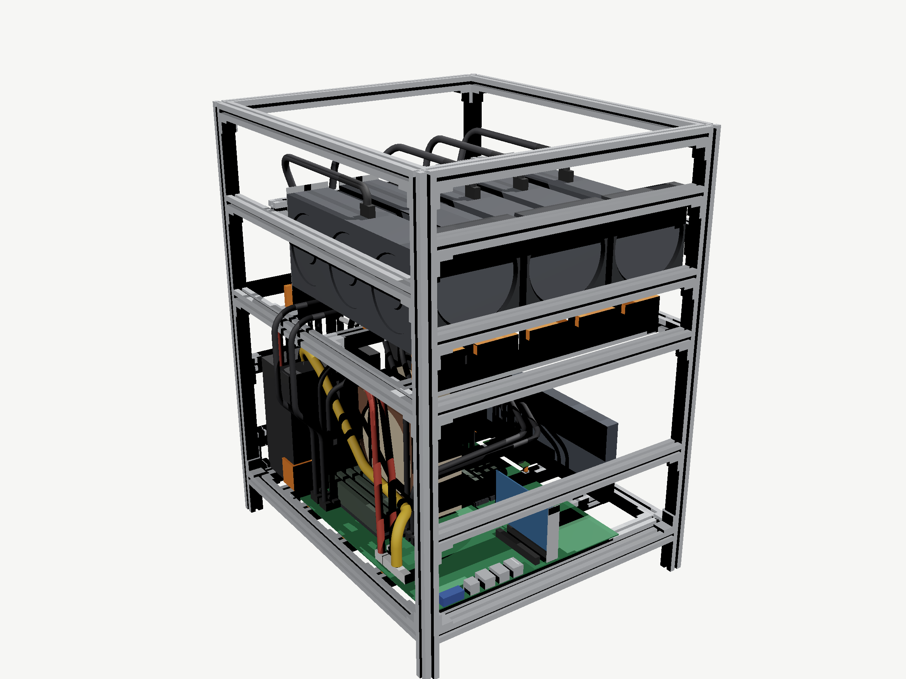
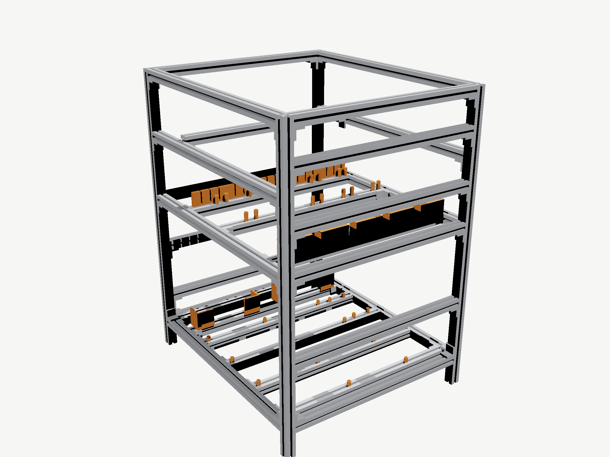
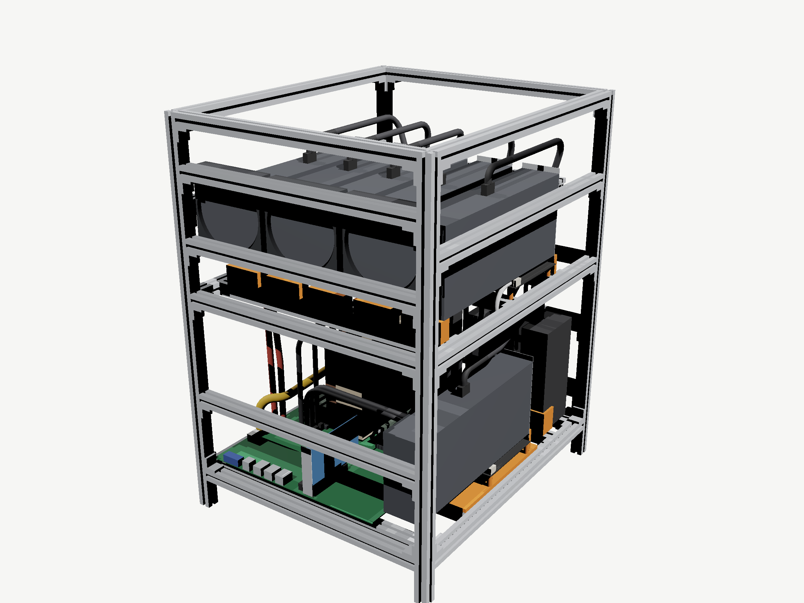
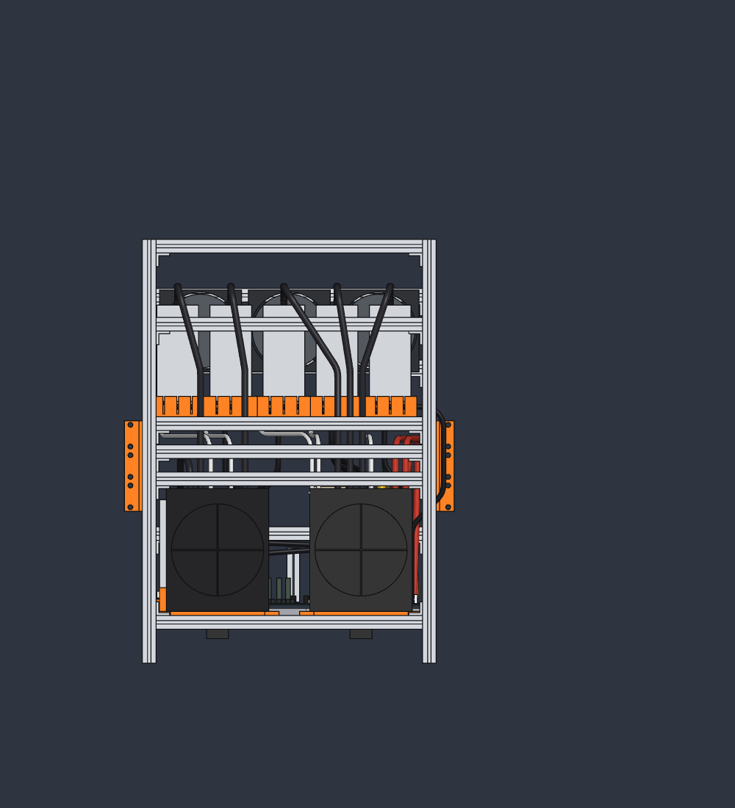

# DIY AI GPU Server – open 19" frame for 5–6 consumer GPUs (RTX 4090)

An open-hardware **DIY AI / LLM server case** for people who want to run **multiple consumer graphics cards** (RTX 4090 and similar 3-slot cards) in a homelab or a 19" rack. It is built from standard **20×20 aluminium extrusion**, a few 3D-printed parts and **PCIe risers on SlimSAS cables**. Every GPU gets a full x16/x8 link and a clean airflow path, and the whole thing fits into **14U**.

> [!WARNING]
> **Very early stage.** The first extrusion frame has been assembled, but nothing has been tested yet (no electronics, no printed parts, no plates). Lessons from that build are going into the model step by step (see [Changes since the first release](#changes-since-the-first-release)), so expect further changes to dimensions, parts and cable routes. Please don't order parts based on this version unless you're happy to adapt things yourself.



| | |
|---|---|
|  |  |
| Frame with printed parts | Optional 6th GPU on the board level |

## Key specs

- **GPUs:** 5 × RTX 4090 (305 × 61 × 125 mm, 3-slot) above the board, all facing the same way for consistent airflow, 16.8 mm intake gap in front of every card; **optional 6th GPU** on the board level.
- **Connection:** C-Payne PCIe device adapters (x8/x16 BOTTOM rev. 2) and 500 mm round SlimSAS 8i cables. Every route is checked for length (max. 460 mm) and bend radius (≥ 25 mm).
- **Mainboard:** ASRock Rack ROMED16QM3 (AMD EPYC SP3, SSI-EEB), Noctua NH-U14S TR4-SP3, 8 × RDIMM. The board sits on a printed SSI-EEB tray (third party, BSD licence).
- **Power:** 2 × Silverstone ZEUS 1650R, upright on printed PSU feet with the bottom (exhaust + inlet) and the rear fan side left completely open; all 12V-2x6 / EPS / 24-pin routes checked against the stock cable lengths.
- **Frame:** 20×20 I-type slot 5 extrusion. The cut list is only three lengths: 4 × 621, 20 × 390 and 8 × 460 mm. 56 corner brackets.
- **Size:** 430 × 500 × 621 mm (W × D × H, incl. 50 mm feet) = **19", 14U**. It stands on rails or a shelf; printed rack ears are optional.
- **Parametric:** all main dimensions are parameters (`cad/parameters.csv`), so the design adapts to other cards, boards and PSUs.

## Repository layout

| Folder | Content | Open with |
|---|---|---|
| `cad/assembly/` | Full assembly as **STEP AP242** (`diy-ai-gpu-server.step`), frame + printed parts only (`frame-and-printed-parts.step`), **3MF**, **OBJ + MTL with colours** (zipped) | STEP: FreeCAD, Fusion 360, Onshape, SolidWorks, Inventor, Creo, Solid Edge, Rhino, KiCad (3D viewer) · 3MF: PrusaSlicer, Bambu Studio, OrcaSlicer, Cura, Windows 3D Viewer · OBJ: Blender, MeshLab, any 3D viewer |
| `cad/parts/` | Extrusions (390 / 460 / 621 mm) and the corner bracket as STEP | any CAD |
| `cad/parameters.csv` | All driving dimensions (names + expressions) | spreadsheet |
| `cad/source/` | Native, fully parametric source (`.solidcraft`, SolidCraft) | SolidCraft |
| `print/stl`, `print/3mf`, `print/step` | Every printed part, one file per part type | slicer / CAD |
| `print/third-party/` | Third-party printed parts with their own licence (mainboard tray by DockGuy, BSD) | slicer |
| `drawings/dxf`, `drawings/svg` | 2D views (front, left, top, iso) of the assembly and the frame | DXF: LibreCAD, QCAD, AutoCAD, DraftSight, FreeCAD · SVG: browser, Inkscape |
| `bom/` | Bill of materials, cut list, frame hardware, T-nuts per extrusion (CSV) | spreadsheet |
| `sheet-metal/` | **Untested** flat plates (base plate, stackable fan panels) as DXF for laser / waterjet / CNC, plus SVG, hole tables, STEP | DXF: any CAM / laser software, LibreCAD, QCAD · STEP: any CAD |
| `sheet-metal/cladding/` | **Untested** full cladding (top cover, rear, front, side panels, 1.5 mm honeycomb) and a 15-fan airflow layout | as above |
| `docs/assembly-guide/` | Illustrated step-by-step **assembly guide (PDF)** + Typst source | PDF reader |
| `images/` | Renderings | — |

## Assembly guide

> [!NOTE]
> The assembly guide still shows the state of the first release (29 Oct 2026). It does not yet include the mainboard tray, the PSU feet and the frame changes listed under [Changes since the first release](#changes-since-the-first-release).

**[docs/assembly-guide/assembly-guide.pdf](docs/assembly-guide/assembly-guide.pdf)** covers tools, consumables, a parts overview, 16 illustrated steps, the cable tables (SlimSAS ports, PSU cables with spare length), the checks to do before building, and the BOM.

Build the PDF yourself with [Typst](https://typst.app) ≥ 0.13:

```sh
cd docs/assembly-guide
typst compile --root ../.. assembly-guide.typ
```

## Printed parts

PETG. Parts are exported in their **assembly position**, so rotate them flat on the bed in your slicer. Suggested settings: 0.2 mm layers, 4 perimeters, 40 % infill.

| File | Qty | Use | Status |
|---|---|---|---|
| `third-party/dockguy-modular-mainboard-tray/` | 1 set (6 parts) | SSI-EEB mainboard tray, see its [README](print/third-party/dockguy-modular-mainboard-tray/README.md) | ready |
| `psu-foot` | 2 | PSU foot (frame) for the upright ZEUS 1650R | ready, check the hole pattern |
| `standoff-8x10` | 4 | M.2 riser standoff, M3 heat-set insert | geometry ready, fixing open |
| `standoff-8x18-riser` | 20 (+4 for 6th GPU) | GPU riser standoff, M3 heat-set insert | geometry ready, fixing open |
| `gpu-front-rest` | 5 | GPU front rest on the front support | **placeholder** |
| `bracket-comb-1` | 1 | Slot bracket comb, GPU1-2 | **placeholder** |
| `bracket-comb-2` | 1 | Slot bracket comb, GPU3 | **placeholder** |
| `bracket-comb-3` | 1 | Slot bracket comb, GPU4-5 | **placeholder** |
| `gpu6-holder-optional` | 1 (optional) | 6th GPU holder | **placeholder** |
| `rack-ear-left-optional` | 1 | 19" rack ear left (optional) | ready |
| `rack-ear-right-optional` | 1 | 19" rack ear right (optional) | ready |

- **Placeholders:** the GPU rests, the combs and the 6th-GPU holder are simple blocks in the model so far. They have no screw holes yet, so don't print them.
- **Standoffs:** they take an **M3 heat-set insert** (Ø4 × 5.7 mm) on top. How they are fixed to the T-nut below is still open, because an M4 screw from the top can't pass the insert bore. One option is an M4 heat-set insert at the bottom plus an M4×10 set screw into the T-nut, so the standoff is simply screwed on.

### PSU foot



- **Shape:** one frame per PSU. The PSU stands upright with its ATX rear face (exhaust grille + inlet) pointing down. The foot only holds it at the edge, with a 4 mm ledge and bosses around the screw holes, so the bottom stays open.
- **On the frame:** at the front the foot lies on PSU rail 1, at the rear on the base rear member. Four M4×12 go into the T-nuts of PSU rail 1, and two 16 mm deep side ribs make it stiff.
- **PSU to foot:** the PSU is screwed on from below with its own #6-32 screws, with the heads in 3 mm counterbores.
- **Hole pattern:** the ATX pattern is drilled in all four possible orientations (12 bosses), because the orientation on the real ZEUS 1650R is not verified yet. Once you know yours, 8 bosses can go.
- **Print:** top face down on the bed, no supports.

## Frame hardware

See [`bom/frame-hardware.csv`](bom/frame-hardware.csv). The article numbers are from one example supplier (Dold Mechatronik, Germany); any 20×20 I-type slot 5 system works. **Important:** with I-type slot 5 the T-nuts can **not** be inserted afterwards, so slide them in before joining. [`bom/t-nuts-per-extrusion.csv`](bom/t-nuts-per-extrusion.csv) lists how many go into each extrusion (186 in total, 112 of them come with the brackets). If one is missing later, there are no drop-in hammer nuts for I-type slot 5 at the example supplier, so check this list carefully before joining.

## Status / known limitations

These are placeholders in the model; please check them against your real hardware (also listed in the guide):

- **SlimSAS plug under the neighbouring riser:** after the 45 mm rigid plug each cable passes very close (model: 0.5 mm overlap) under the edge of the riser to its left. If it collides, raise the neighbouring riser by 2–3 mm.
- **Left-side overhang:** the two GPU1 cables stick out about 15 mm on the left, so leave room in the rack.
- **Standoff fixing:** how the printed standoffs are fixed on the T-nuts is not designed yet.
- **PSU rail 1 brackets:** in the model the two brackets were moved to the rear side of the rail, not mirrored. On the real frame turn them round so they sit correctly behind the rail.
- **M.2 riser standoffs:** they move with board rails 3 and 4, so their spacing is now 87.3 mm instead of 90 mm. The M.2 riser hole pattern is still a placeholder; check it against the real card.
- **Model vs. build:** the model is the design state. The first real frame differs in at least one extra 390 mm member, which is not in the model yet.
- **Riser details:** the 6-pin socket position and the mounting holes of the C-Payne riser are placeholders.
- **Power budget:** PSU 1 feeds CPU, board and three RTX 4090s. A GPU power limit of about 350–400 W is recommended.
- **Language of the source:** component names inside the CAD source are German. Pull requests with English naming are welcome.

## Changes since the first release

The frame changes below were made against the real first frame. None of the parts has been fitted yet.

1. **Mainboard tray instead of 12 printed board standoffs.** It is a printed SSI-EEB tray by DockGuy (see [`print/third-party/`](print/third-party/dockguy-modular-mainboard-tray/README.md)). The board now sits 6 mm higher (Z 36), and nothing collides. Two follow-ups:
   - The NIC rail moves 6 mm up with it.
   - The SlimSAS cables C1/C2 pass only 0.3 mm above the RAM, so lift them a little when routing.
2. **Board rails moved to the tray's screw rows.** Rail 1 moves +3.2 mm, rail 3 +4.3 mm and rail 4 −8.4 mm in Y. The tray is then held by 12 × M4×16 in the existing T-nuts. Rail 2 only supports the tray.
3. **PSU mount:** the PSU bottom is now open.
   - The four printed PSU holders are replaced by two PSU feet.
   - PSU rail 1 moves 20 mm forward (Y 374–394), in front of the PSUs, and its brackets go to its rear side.
   - PSU rail 2 is removed, which saves 1 × 390 mm and 2 brackets. The PSUs stand 6 mm higher.
4. **PSU fans free.** The ZEUS fan is on the rear face. The two rear rails ran across it at Z 60–80 and Z 180–200. Both now sit above the PSUs, at Z 210–230 and Z 250–270, below the mid-frame brackets.
5. **Fans:** the front fans are Arctic P12 Pro PST (PWM, daisy-chain capable).
6. **Sheet-metal fan panel:** the three Ø110 openings are replaced by a honeycomb field (5 mm hexagons, 2 mm web) inside the rectangle of the outer fan screw holes.
7. **New, untested:** a full cladding variant with a 15-fan airflow layout, in [`sheet-metal/cladding/`](sheet-metal/cladding/).

## Roadmap

- [ ] **First build:** assemble the frame and check the fit (risers, SlimSAS routing, PSUs, standoffs)
- [ ] **Fixes from the build:** update the CAD, BOM and assembly guide with whatever the real build shows
- [ ] **Fan layout:** a 15-fan plan for the cladding variant is in [`sheet-metal/cladding/`](sheet-metal/cladding/); still to be measured
- [ ] **Photos of the finished rig**
- [ ] **Measurements:** GPU/CPU temperatures, fan speeds, noise and power draw under sustained AI/LLM load
- [ ] **Full cladding:** 1.5 mm honeycomb panels, first draft in [`sheet-metal/cladding/`](sheet-metal/cladding/), not cut or tested yet.
- [ ] **Sheet-metal variant:** flat laser/waterjet-cut plates (base plate + stackable fan panels) as an alternative to some of the inner extrusions. First draft is in [`sheet-metal/`](sheet-metal/) but has not been cut or tested yet.

## Contributing

Issues and pull requests are welcome: builds with other boards (WRX80, TRX50, SP5), other GPUs (RTX 3090 / 5090), measured riser and plug dimensions, photos of your build.

## License

Hardware design, documentation and images: **[CERN Open Hardware Licence Version 2 – Permissive](LICENSE)** (CERN-OHL-P-2.0).

**Exception:** the mainboard tray in [`print/third-party/dockguy-modular-mainboard-tray/`](print/third-party/dockguy-modular-mainboard-tray/) is by DockGuy and stays under its original **BSD licence** (see the `LICENSE` file there). The same tray meshes are embedded in `cad/source/diy-ai-gpu-server.solidcraft` and in the assembly 3MF/OBJ. The STEP exports don't contain them. Product names and trademarks belong to their owners; the component models (GPU, mainboard, PSU, cooler) are simplified placeholders, not manufacturer data.

---

*Keywords: DIY AI server, multi-GPU server, consumer GPU server, RTX 4090 server, 4× / 5× / 6× GPU rig, LLM inference server, local AI, homelab GPU rack, open hardware case, aluminium extrusion case, 2020 extrusion, PCIe riser, SlimSAS, EPYC, 19 inch rack 14U.*
