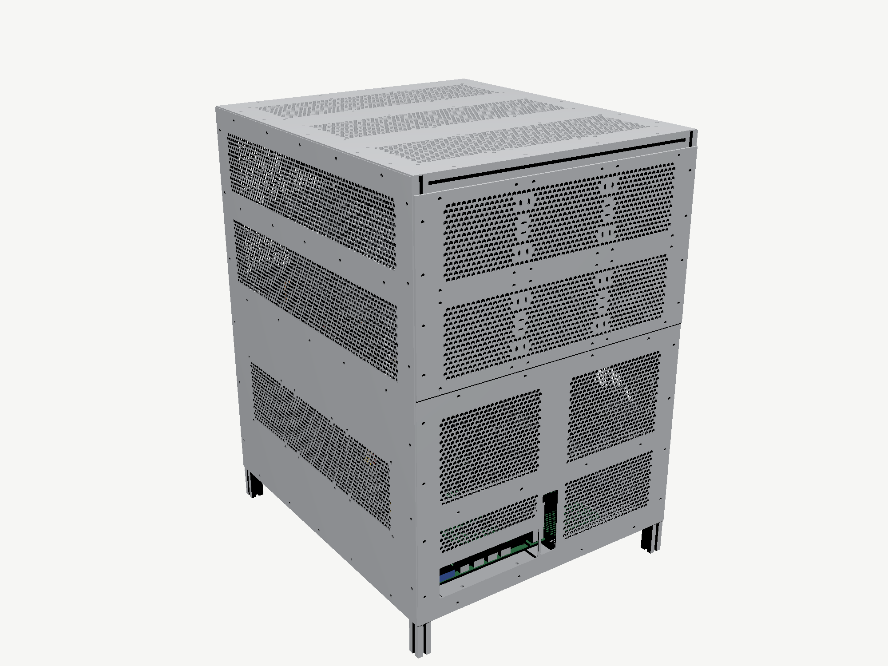

# Full cladding variant (untested)

> [!WARNING]
> **Untested and early stage.** None of these panels has been cut or fitted yet. Check the points at the end against your real hardware before ordering.

This variant closes the case completely with flat **AlMg3 / EN AW-5754, 1.5 mm** panels with a honeycomb perforation, and uses a 15-fan airflow layout.

- **Builds on the sheet-metal variant:** it reuses the base plate and the two 3 mm fan panels at the front, see [`../`](../).
- **Main design unchanged:** the extrusion-only design is not affected by this variant.

## Panels (flat cuts only, no bending)

| File | Part | Qty | Size (mm) | Openings | Hexagons |
|---|---|---:|---|---|---:|
| `top-cover-3x3x120_*` | Top cover with fan mounts (used in the model) | 1 | 430 × 500 | Screw points for **3 rows of 3 × 120 mm fans** (105 mm pattern, rows at Y 92, 250, 408). Honeycomb **only under the fan rows**, each inside the rectangle of the outer fan screw holes (365 × 105 mm); the rest stays closed. | 2,757 |
| `top-cover-honeycomb_*` | Top cover without fans (option) | – | 430 × 500 | Honeycomb over almost the whole area (GPU exhaust upwards), three fields with 6 mm webs at Y 167 and Y 333 | 4,313 |
| `rear-panel_*` | Rear panel | 1 | 430 × 571 | Honeycomb circles Ø132 in front of the PSU fans, honeycomb over the whole GPU level | 2,869 |
| `front-lower-panel_*` | Front panel, board level | 1 | 430 × 311 | I/O window 160 × 45 and NIC bracket window (placeholders), two intake honeycomb fields, closed in front of the NIC rail (Z 133–153) | 1,565 |
| `side-panel-honeycomb_*` | Side panel without fans | as needed | 500 × 571 | Honeycomb on the GPU level (above and below the side rail) **and on the whole board level**, where the CPU cooler draws air from the left | 5,121 |
| `side-panel-3x120_*` | Side panel with 3 × 120 mm fans (left and right in the model) | 2 | 500 × 571 | GPU level as above; on the board level 3 fans (105 mm pattern) with honeycomb inside the rectangle of the outer fan screw holes | 3,131 |
| `side-panel-3x140_*` | Side panel with 3 × 140 mm fans (only if you use 140 mm fans) | as needed | 500 × 571 | as `3x120`, with the 140 mm pattern (124.5 mm) | 3,387 |

Each panel comes as `.dxf` (for cutting), `.svg` (preview) and `_holes.csv` (hole table). The STEP files are in `cladding-step.zip`, because they are large.

- **Side panels:** left and right are the same part; choose a variant per side. The model uses `side-panel-3x120` on both sides: 3 fans blow in on the left, 3 blow out on the right, matching the cooler, which blows to the right (+X). The side fans sit **inside** on the board level (Z 85–225) and are bolted through the panel with M4×30 + nut.
- **Front:** the GPU level at the front is covered by the two 3 mm fan panels of the sheet-metal variant (honeycomb, 2 mm web).
- **Bottom:** stays open, because the PSUs blow out downwards and their plugs point down.
- **Rack ears:** not used. The clad case stands on rails or a shelf.

### Honeycomb

- **Size:** hexagons with 5 mm across flats and a 1.5 mm web (web = sheet thickness), about 59 % open area. The model (cover with fan mounts, both sides 3 × 120) has about 13,500 cells. There is at least 3 mm of material around every hole.
- **Grid:** centred on each field, so the pattern is symmetric to all edges.
- **Manufacturing:** made for laser or waterjet; too fine for milling.
- **DXF:** R12, mm, 1:1; hexagons as closed POLYLINE, holes as CIRCLE; layers `CUT` and `ENGRAVE`.
- **STEP and model split:**
  - A SolidCraft sketch holds about 3,170 contours, so the cover is three bodies and each side panel two in the model.
  - The DXF always has the whole part. The STEP has the bodies, which meet without a gap.
  - The STEP contains the real perforation.

## Fans and airflow

The layout uses **15 × Arctic P12 Pro PST** (120 × 120 × 25, 105 mm pattern, 600–3000 rpm, 0.33 A, 400 mm cable plus an 80 mm daisy-chain lead). They are wired in **5 chains of 3**, one chain per board header. **9 fans blow in and 6 blow out.** The slight overpressure pushes extra warm air out through the honeycomb of the rear panel and the cover, and no warm air is drawn back in from behind the rack.

| Chain | Where | Direction | Header |
|---|---|---|---|
| A | front, lower row of the GPU level | in, blowing to the rear (+Y) | FAN1 |
| B | front, upper row of the GPU level | in, blowing to the rear (+Y) | FAN2 |
| C | inside under the cover, rearmost row (Y 348–468) | out, blowing up (+Z) | FAN4 |
| D | right side, board level | out, blowing to the right (+X) | FAN6 |
| E | left side, board level | in, blowing to the right (+X) | FAN3 |

**Why this layout:**
- **GPU level:** the five cards face left in a row and form a wall across X. Air only passes through the 17 mm gaps between the cards, which run front to back, so the air comes in from the front (A, B). The cards shed most heat at their top and bottom edges; chain C pulls it out at the top.
- **Board level:** the NH-U14S blows to the right. E pushes cool air in from the left and D pulls it out on the right (push-pull across the cooler). The same flow also takes away the heat that falls down from the lower card edges.
- **PSUs:** they draw air through the honeycomb circles of the rear panel and blow down into the space between the feet, independent of the chains.

**Notes:**
- **No side fans on the GPU level:** on the right, GPU5 reaches X 409, so a 25 mm fan has no room. On the left, a fan row would mostly help GPU1, because the row of cards blocks the airflow across.
- **6th GPU (option):** it sits directly against the right side fans, so chain D loses a lot of flow with a 6th GPU.
- **Spare cover rows:** the cover has screw points for two more fan rows, at the front and in the middle (up to 9 fans on top). Only the rearmost row is fitted, so the front air has to pass along the cards before it is pulled out at the top.
- **BMC and daisy-chain:** with PST only the first fan of a chain reports its speed. The P12 Pro stops below 5 % PWM, and the ASRock Rack BMC may then treat it as failed and run all fans at 100 %. Set a minimum duty above 5 % or lower the lower speed threshold in the BMC.

### Fan wiring

The ROMED16QM3 has 8 fan headers. FAN1–FAN5 are on the left board edge (about X 30–50 / Y 165–240), FAN6–FAN8 at the rear right (about X 300 / Y 343). These positions are read from the layout image in the manual (±5 mm). FAN5, FAN7 and FAN8 stay free.

| Chain | Cable run to the first fan | Does the 400 mm cable reach? |
|---|---:|---|
| A | about 470 mm | not quite: **30 cm PWM extension** |
| B | about 590 mm | no: **30 cm PWM extension** |
| C | about 570 mm (up the left wall) | no: **30 cm PWM extension** |
| D | about 250 mm | yes |
| E | about 100 mm | yes |

Within a chain the 400 mm cable is plenty. Turn the first fan of each chain so that its cable leaves at the corner nearest the board. On every fan, the arrow on the frame points in the direction given in the table.

## Mounting

All panels screw onto the outside of the frame. The holes sit on the slot centre.

| Item | Qty |
|---|---:|
| M4 nut for I-type slot 5 (see note) | 134 |
| Button head screw ISO 7380 M4×8 | 134 |
| Arctic P12 Pro PST 120 × 120 × 25 (sides + cover, in addition to the 6 at the front) | 9 |
| M4×30 + M4 nut (side and cover fans) | 36 + 36, plus 12 + 12 per extra cover row |
| 4-pin PWM extension, 30 cm (chains A, B, C) | 3 |

| Part | Mounting holes |
|---|---:|
| Top cover | 18 |
| Rear panel | 32 |
| Front lower panel | 20 |
| Side panels | 2 × 32 (+12 fan holes per side panel with fans) |

> [!IMPORTANT]
> **Open sourcing question:** fitting the panels afterwards needs drop-in (roll-in / hammer) nuts for **I-type slot 5**. The example supplier only has them for slot 6 and slot 8, and most "hammer nuts for 20 series" are made for slot 6. Until a source is found, slide normal T-nuts into the right extrusions **before** the frame is joined (134 extra).

## Cable change in this variant

The SlimSAS cables of GPU1 (A1/A2) run **inside** instead of outside the case. This assumes a 30 mm rigid plug end (instead of 45 mm) and a tight bend after it. In the model the tightest bend is about 12 mm and the length 321 mm. To make room, the EPS cables on the left now run at X 44 and X 56. A clearance check of all new and changed parts shows no overlap. For that check the panels were tested as solid plates without holes, which is stricter than the perforated panels.

## Check before cutting

- **I/O and NIC windows:** check their position against the real I/O shield of the ROMED16QM3 (rotated 180°) and the NIC.
- **GPU1 cables:** check on the real cable that it can bend this tightly after 30 mm.
- **Rear panel:** in this variant the two rear rails (Z 60–80 and 180–200) still run across the PSU fans and cover part of their intake. The main design has already moved them above the PSUs; this variant hasn't been updated yet.
- **Mounting nuts:** see the sourcing note above.
